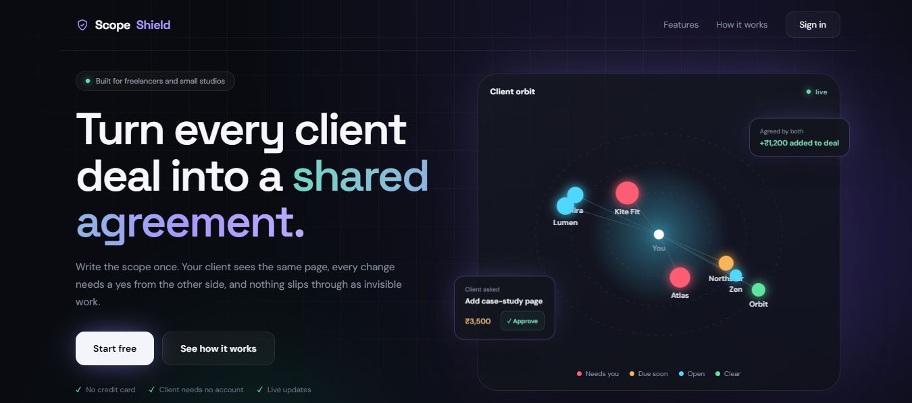
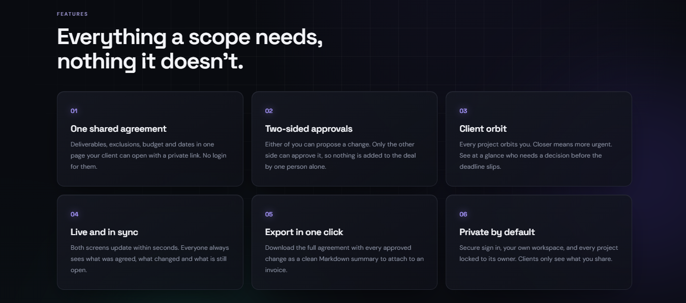
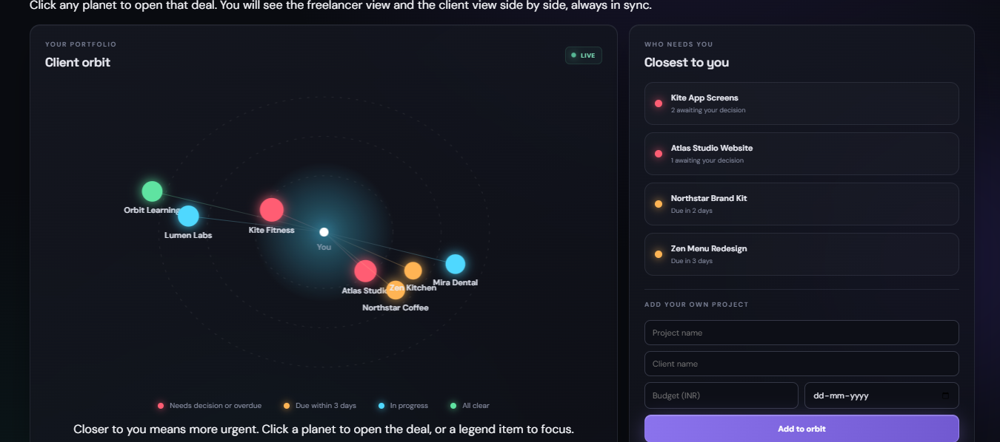
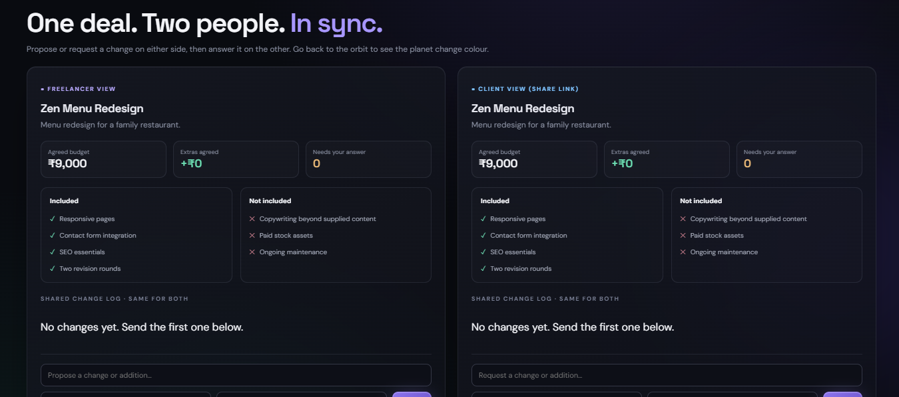

# ScopeShield

**Keep the project. Protect the scope.**

ScopeShield helps freelancers and small studios prevent scope creep: the quiet expansion of client work beyond the original agreement. Define deliverables and exclusions before work begins, record extra requests with their cost and schedule impact, then track the decision instead of doing invisible work.

## Screenshots



| | |
|---|---|
|  |  |
| **Landing page.** Features and how it works | **Client orbit.** Every project circles you, closer means more urgent |


*One deal, two people: the freelancer view (left) and the client view (right) stay in sync.*

## Features

- **Landing page and secure sign in** — marketing page with a live orbit hero, email and password accounts, and every project locked to its owner.
- **Portfolio dashboard** — active projects, pending change value, tracked budget and activity.
- **Client orbit** — a smooth animated map on the dashboard: you in the centre, every project orbiting you. Colour shows the situation (needs decision or overdue, due within 3 days, in progress, all clear), distance shows urgency and size shows budget. Hover to slow a planet, click to open it, use the legend to focus. Code: `client/src/orbitEngine.js` and `OrbitPanel.jsx`.
- **Scope records** — client, project type, budget, due date, overview, deliverables and exclusions.
- **Change control** — record additional requests, cost and timeline impact; approve or decline them.
- **Scope export** — download a project agreement summary as Markdown.
- **Shared deal with your client** — press *Share with client* on any project to copy a private link. The client sees the same agreement (scope, exclusions, budget and every change) and can request changes. Either side can propose a change; only the *other* side can approve or decline it, so nothing becomes part of the deal unless both agreed. Both screens refresh every few seconds.
- **Search and filters** — quickly find projects and filter by status.
- **Persistent backend** — Express REST API with MongoDB (Atlas free tier works), or a local JSON file when no database is configured.
- **Premium responsive UI** — dark glass surfaces, violet glow, cursor spotlight and glowing panel edges, staggered page transitions, shimmering progress bars, spring-eased modals, mobile navigation and reduced-motion support. The motion layer lives in `client/src/polish.css` and `polish.js`, so it can be tuned or removed without touching the app code.

## Stack

- React 18 + Vite
- Lucide React icons
- Plain CSS design system
- Node.js + Express REST API
- MongoDB (official driver) with JSON-file fallback

## Run locally

Requirements: Node.js 18 or newer and npm.

```bash
npm run install:all
npm run dev
```

- Frontend: http://localhost:5173
- API health check: http://localhost:5050/api/health

Install and run separately if preferred:

```bash
cd server
npm install
npm run dev
```

In a second terminal:

```bash
cd client
npm install
npm run dev
```

The frontend uses `http://localhost:5050/api` by default. Set `VITE_API_URL` in a client `.env` file if your API runs elsewhere. For deployment, set `CLIENT_ORIGIN` on the API server to your frontend origin(s), separated by commas.

## Project structure

```
scopeshield/
├── client/                    React + Vite frontend
│   ├── index.html
│   └── src/
│       ├── main.jsx           entry: landing, sign in, dashboard or client link
│       ├── App.jsx            dashboard, projects, change requests, settings
│       ├── ClientPortal.jsx   what the client sees via the share link
│       ├── OrbitPanel.jsx     Client orbit panel for the dashboard
│       ├── orbitEngine.js     canvas orbit animation (framework-free)
│       ├── landing.js         landing page
│       ├── authCard.js        sign in / create account card
│       ├── auth.js            token storage and auth API calls
│       ├── styles.css         base design system
│       ├── polish.css         glow, motion and orbit styles
│       ├── polish.js          cursor spotlight on panels
│       └── landing.css        landing page and auth card styles
├── server/                    Express REST API
│   ├── index.js               routes, MongoDB / JSON storage, authorization
│   ├── auth.js                password hashing, JWT, rate limiting
│   ├── auth.test.js           unit tests for auth
│   ├── data/db.json           sample projects (seed data)
│   └── .env.example           settings template
├── docs/                      README screenshots
├── package.json               scripts for running both apps
└── LICENSE                    MIT
```

## How the shared deal works

1. Freelancer creates a project and presses **Share with client** (project page). The link looks like `http://localhost:5173/?share=<token>`.
2. Client opens the link (no login). They see the agreement and the shared change log.
3. Client taps **Request a change**. The freelancer sees it as *Client asked* with Approve / Decline buttons.
4. Freelancer proposes extra work from **Add change**. The client sees it as *Freelancer proposed* with Agree / Decline buttons, and the freelancer sees *Waiting for client*.
5. Approved items add to the agreed budget on both screens.

The server enforces this: the person who proposed a change cannot approve it themselves (HTTP 403). Existing records without a proposer count as client requests.

> The share link works like a password. Anyone who has it can see that project and send requests, so share it only with your client. Real accounts are a sensible next step before using this with sensitive deals.

## REST API

| Method | Route | Purpose |
|---|---|---|
| GET | `/api/health` | API health check |
| GET | `/api/dashboard` | Dashboard stats, projects and activity |
| GET | `/api/projects` | List projects; supports `q` and `status` query parameters |
| POST | `/api/projects` | Create a project scope |
| GET | `/api/projects/:id` | Fetch a project |
| PATCH | `/api/projects/:id` | Update project details |
| DELETE | `/api/projects/:id` | Delete a project |
| POST | `/api/projects/:id/changes` | Record a change request |
| PATCH | `/api/projects/:id/changes/:changeId` | Set a request to Pending, Approved or Declined |
| GET | `/api/projects/:id/export` | Export scope as Markdown |
| GET | `/api/share/:token` | Client: view the shared project |
| POST | `/api/share/:token/changes` | Client: request a change |
| PATCH | `/api/share/:token/changes/:changeId` | Client: Approved or Declined, for freelancer-proposed changes only |

## Landing page, sign in and authorization

- **Landing page** — visitors see a marketing page with the live client orbit in the hero. *Start free* creates an account, *Sign in* opens the login card.
- **Authentication** — email and password. Passwords are hashed with scrypt (random salt), login returns a signed JWT (HS256, 7 days) that the app sends as `Authorization: Bearer <token>`. Login and register are throttled per IP to slow brute-force attempts.
- **Authorization** — every `/api/projects` and `/api/dashboard` route requires a valid token and only returns or changes projects whose `ownerId` is the signed-in user, so one user can never read or edit another user's projects. Clients use the private share link (`/api/share/:token`), which exposes only that one project and never the owner's id.
- **First account** — the first account you create adopts any existing sample or pre-login projects, so your current data is not lost.
- **Set `JWT_SECRET`** before deploying (see `server/.env.example`). Without it a temporary secret is used and everyone is signed out on each restart.
- Tokens are kept in `localStorage`, which keeps the Vercel + Render setup simple. If you later need stricter protection against script injection, move the token to an httpOnly cookie.

| Method | Route | Purpose |
|---|---|---|
| POST | `/api/auth/register` | `{name, email, password}` returns `{token, user}` |
| POST | `/api/auth/login` | `{email, password}` returns `{token, user}` |
| GET | `/api/auth/me` | Current user (needs token) |

Run the auth unit tests with `cd server && npm test`.

## Add your own projects

1. Open the app and press **New project** (Overview or Projects page).
2. Fill in the name, client, budget, due date, overview, deliverables and exclusions (one per line) and save.
3. The project appears in your table and as a new planet in the Client orbit. Open it and press **Share with client** to invite your client.

Want an empty workspace instead of the sample projects? Set `SEED_SAMPLE=false` (MongoDB) before the first start, or delete the samples from each project page.

## MongoDB setup

1. Create a free cluster at [MongoDB Atlas](https://www.mongodb.com/atlas), then **Database Access**: add a user, **Network Access**: allow your IP (or `0.0.0.0/0` for Render).
2. Click **Connect, Drivers** and copy the connection string.
3. Locally: copy `server/.env.example` to `server/.env`, paste the string into `MONGODB_URI`, run `npm run install:all` then `npm run dev`. The API log should say `Storage: MongoDB connected`, and `/api/health` shows `"storage":"mongodb"`.
4. On Render: add `MONGODB_URI`, `MONGODB_DB` and `CLIENT_ORIGIN` under **Environment**. Your data now survives redeploys.

Without `MONGODB_URI` the API falls back to `server/data/db.json`. On first connect to an empty database the sample projects are copied in from that file. If `MONGODB_URI` is set but the connection fails, the server stops with a clear error instead of silently losing data.

## Deploy

1. **API (for example Render):** root directory `server`, build command `npm install`, start command `npm start`. Add `MONGODB_URI`, `MONGODB_DB`, `JWT_SECRET` and `CLIENT_ORIGIN` (your frontend URL) under Environment.
2. **Frontend (for example Vercel):** root directory `client`, build command `npm run build`, output directory `dist`. Add `VITE_API_URL` set to `https://your-api.onrender.com/api`.
3. Open your frontend URL, create an account, add a project and press **Share with client**.

## Data and deployment notes

- With no `MONGODB_URI`, data is kept in `server/data/db.json`. Back up this file before resetting or replacing it.
- A deployed instance using an ephemeral filesystem may lose JSON data on redeploy. Use a persistent disk or a database for a real multi-user production app.
- This is a portfolio-ready starter, not a hosted production service. It does not include authentication or per-user authorization; do not expose private client records publicly without adding those controls.

## License

MIT. See [LICENSE](./LICENSE).
